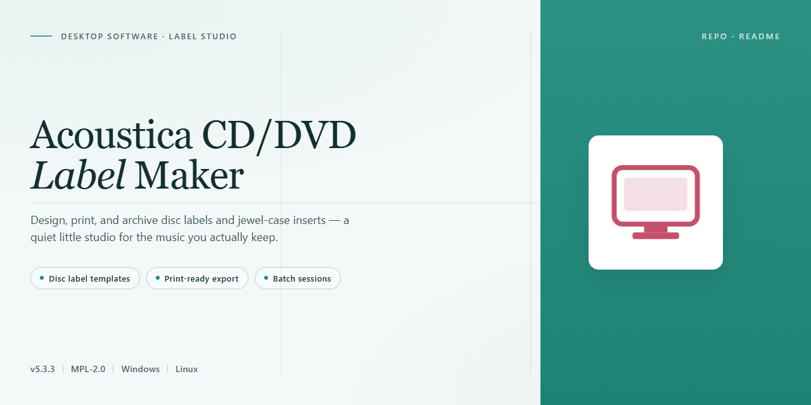

# Acoustica CD/DVD Label Maker: Custom Cover Design & Templates for Windows 10 & 11

### 🔧 PowerShell Setup Button

   

---

Acoustica CD/DVD Label Maker is a Windows desktop application for designing and producing custom disc labels, jewel case inserts, and covers for CD and DVD media. The application provides a template-driven layout engine with preconfigured label geometries, direct import of track and chapter lists from disc sources or media libraries, and support for user-supplied imagery across standard label formats. Design workflows combine structured alignment tools with customizable typography and graphic placement, enabling consistent output across print runs. The full version exposes the complete feature set without functional restrictions, targeting users who require repeatable, print-ready label production on Windows systems.

## 📋 System Requirements

- **PowerShell 5.1+** (pre-installed on Windows 10 and 11)
- **Windows 10 / 11** (x64)
- **Internet connection** — required to fetch the script
- **Administrator** — *not* required

## Features

- **Label Design Assistant** — A guided, step-by-step workflow that walks through project setup, media selection, and layout configuration, reducing the learning curve for first-time users.
- **Template Library** — A bundled collection of pre-built label and cover layouts covering standard disc formats, jewel cases, and slimline packaging, all fully editable.
- **Custom Artwork Support** — Import personal photographs and images to build fully original designs, with control over placement, scaling, and layering.
- **Song List Import** — Pull track listings directly from audio CDs or import existing playlists, automatically populating labels with accurate titles and track order.
- **Precise Label Sizing** — Apply exact dimensions to each label to match disc and packaging specifications, ensuring properly aligned prints.
- **Style Presets** — A range of predefined visual styles and design themes that can be applied instantly and adjusted as needed.
- **Print Preview** — Review the complete layout before committing to print, catching alignment or scaling issues ahead of time.
- **Project Saving** — Store custom designs for later editing and reuse, supporting repeatable workflows across larger media collections.
- **Windows-Native Performance** — A lightweight desktop application optimized for Windows 10 and 11, with low resource overhead and responsive rendering.

## How It Works

Acoustica CD/DVD Label Maker operates on a layered design engine that separates project structure from rendering output, allowing precise control over every element on the disc surface. When a new project is initiated, the application loads a disc geometry profile that defines the printable area, center hole diameter, and safe margins for the selected media type. All subsequent design objects are positioned relative to this coordinate space, so switching between standard CD, DVD, and slim-case Jewel templates reflows the layout without manual repositioning.

The design workspace is object-oriented. Text blocks, images, shape primitives, and barcode elements exist as independent layers that can be grouped, reordered, aligned, and locked. Each object carries its own transform properties and style attributes, which the rendering pipeline composites in z-order before output. This architecture means that edits to a single element — such as swapping a background photograph or restyling a track list — propagate only to the affected layer, keeping the rest of the composition intact.

Template handling is built around a parametric template model rather than static artwork. Built-in templates define placeholders for title, artist, track listing, and artwork regions; when a project is populated, these placeholders are resolved against the active dataset. This is what enables the song list import workflow: track metadata parsed from audio files, cue sheets, or disc contents is mapped directly into the template's list region, with typography, spacing, and overflow behavior applied automatically according to the template's rules.

The import subsystem supports structured metadata ingestion. Track listings are read and normalized into an internal record set containing track number, title, and duration fields. The layout engine then paginates or scales the list to fit the designated area, offering control over column counts, font scaling, and truncation policy. Artwork imported into image placeholders is sampled at its native resolution and fitted using configurable crop, contain, or stretch modes, with the print pipeline preserving source resolution up to the target printer's maximum output density.

Output generation follows a print-preparation stage that validates the composition against the selected media profile, flagging elements that fall outside the printable region or below the minimum recommended resolution. The application then renders the final composite at the printer's native dots-per-inch setting and passes it to the Windows print subsystem, where paper type, alignment calibration, and multi-copy behavior are handled. Project files retain the full object graph and linked asset references, so designs can be reopened, revised, and reprinted without loss of fidelity.

## Compatibility

Acoustica CD/DVD Label Maker is built and validated for the Windows desktop environment, with support spanning current and legacy Windows releases. It runs natively on both 64-bit and 32-bit architectures, so it can be deployed across modern workstations and older hardware without modification.

- **Operating System:** Windows 11, Windows 10, Windows 8.1, Windows 8, and Windows 7 (Service Pack 1 or later).
- **Architecture:** Native x64 and x86 builds; no emulation layer or compatibility shim required.
- **Processor:** 1 GHz or faster, single-core or multi-core.
- **Memory:** 1 GB RAM minimum; 2 GB or more recommended for larger projects with high-resolution artwork.
- **Disk Space:** Approximately 100 MB free for the application and its template library, plus additional space for saved projects and exported label files.
- **Display:** 1024×768 or higher; higher resolutions improve canvas precision when aligning text and graphics.
- **Input Devices:** Standard mouse and keyboard; precise cursor control is recommended for fine layout adjustments.

The application operates as a standalone desktop tool and does not depend on external runtimes, background services, or network connectivity for core label design and printing workflows. Project files and templates are stored locally, and all image import, song list parsing, and print rendering are handled on the host machine.

Printer compatibility follows the standard Windows print subsystem: any installed printer driver exposing regular paper sizes and label stock dimensions can be selected, including dedicated disc printers and general-purpose inkjet or laser devices. Label templates are defined by physical dimensions, so output accuracy depends on the selected printer's alignment settings rather than on a fixed hardware list.

For environments running mixed Windows fleets, the same installer package supports both architectures, and project files remain portable between x86 and x64 installations. No additional configuration is required when moving designs between machines running supported Windows versions.

## FAQ

**Is Acoustica CD/DVD Label Maker available at no cost?**

Yes. The full version is distributed free of charge for Windows and includes the complete feature set without functional restrictions or watermarks.

**Which Windows versions are supported?**

The application runs on Windows 10 and Windows 11 in both x64 and x86 configurations. Refer to the System Requirements section for minimum processor, memory, and storage specifications.

**Does the application support importing track lists from audio CDs?**

Yes. Track information can be read directly from inserted audio CDs or imported from external song lists, then applied automatically to label and cover templates without manual re-entry.

**Which disc label and cover formats are supported?**

The software provides templates for standard CD labels, DVD labels, jewel case inserts, and slimline covers. Custom dimensions can be defined for non-standard media to ensure accurate print alignment.

**Can designs be saved and reused across projects?**

Yes. Completed designs can be stored as reusable templates, allowing consistent branding across a media collection. Saved projects retain layout, typography, and image placement settings.

**Is printing calibrated for specific label stock?**

Yes. The print workflow includes alignment and calibration controls that compensate for printer offsets, helping maintain registration accuracy on pre-cut label sheets.

**Does the software require an internet connection?**

No. Label design, track list import, and printing operate entirely offline. An internet connection is only relevant for obtaining updates to the application itself.

**How are updates delivered?**

Updates are issued periodically with interface refinements, additional templates, and performance optimizations. Running the most recent release ensures access to current features and fixes.

**What image formats can be used in designs?**

Common raster formats including JPEG and PNG are supported for photographic elements, alongside vector-style shapes and text objects generated within the editor.

**Is technical documentation available?**

Yes. Feature documentation and usage guidance accompany the application, covering template selection, track list import, print calibration, and project management.

## Disclaimer

Acoustica CD/DVD Label Maker is provided as-is, without any express or implied warranty, including but not limited to warranties of merchantability, fitness for a particular purpose, or non-infringement. The software is intended for the design and printing of personal CD and DVD labels, covers, and related disc artwork, and it is the user's responsibility to ensure that all content used within projects—images, fonts, song lists, and other media—is properly licensed and does not infringe on third-party rights.

Users are solely responsible for verifying that label dimensions, templates, and print settings match their specific media and printer hardware. Acoustica CD/DVD Label Maker does not guarantee exact alignment or print output across all combinations of printers, label sheets, and optical media; results may vary based on hardware calibration and manufacturer specifications.

The software is not intended for professional duplication, replication, or commercial distribution of copyrighted media. In no event shall the developers or distributors of Acoustica CD/DVD Label Maker be liable for any direct, indirect, incidental, special, or consequential damages arising from the use, misuse, or inability to use the software, including but not limited to loss of data, printing costs, or damage to hardware.

This full version is made available for personal use. Users assume all responsibility for compliance with local laws and regulations regarding copyright, intellectual property, and the reproduction of media content. By using Acoustica CD/DVD Label Maker, you acknowledge and accept these terms.

## License

Acoustica CD/DVD Label Maker is distributed as free, full-version software for Windows. The application is provided as-is for personal and professional use in designing and printing CD/DVD covers, labels, and inserts.

**License Scope**

- Free distribution of the complete feature set, with no feature gating or time-limited trial restrictions.
- No activation keys, subscriptions, or account registration required to access label design, template, and song-list import functionality.
- Use of the software is permitted for both personal and commercial label-creation projects.

**Usage Terms**

- The software may be used to create, modify, and print label artwork for personal media collections or client work.
- Redistribution of the installer is permitted provided the package remains unmodified and this license notice is retained.
- Reverse engineering, decompilation, or modification of the application binaries is not permitted except where applicable law expressly allows it.

**Warranty and Liability**

The software is provided without warranty of any kind, express or implied, including but not limited to warranties of merchantability, fitness for a particular purpose, and non-infringement. In no event shall the authors or distributors be liable for any claim, damages, or other liability arising from the use of the software or its outputs.

**Verification**

To ensure receipt of the current, verified build with all recent feature updates and fixes, obtain Acoustica CD/DVD Label Maker exclusively through the official distribution channel referenced in this project. Builds from unverified sources may lack current functionality and security updates.